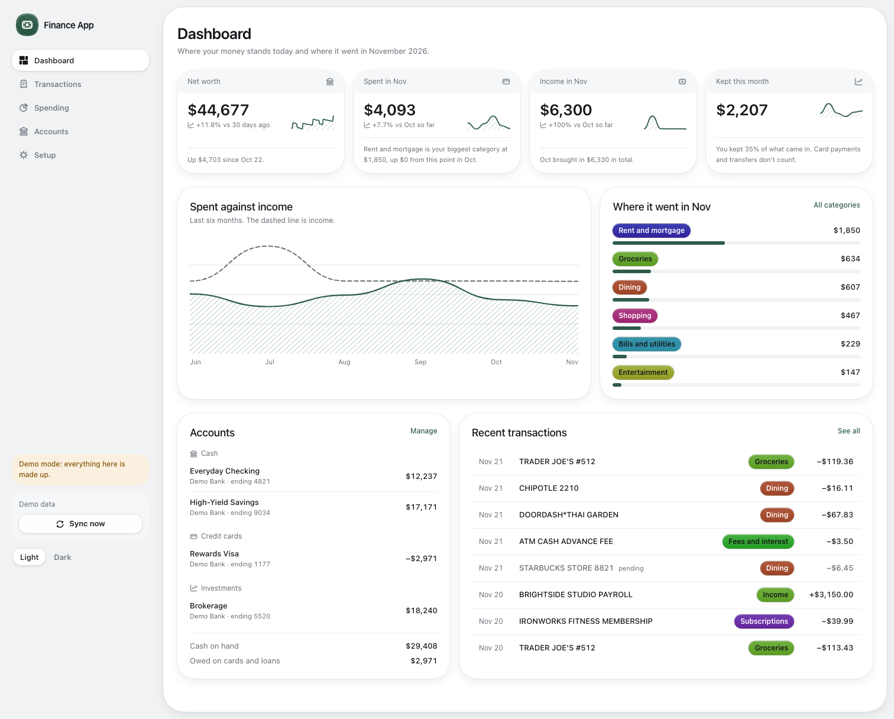

# Finance App

A finance dashboard that runs on your own computer. It shows your balances, your transactions, and where your money goes each month, and it keeps everything in one file on your machine. There's no account to create except a free one with Plaid, the service that lets the app see your bank.

Plaid gives the app read-only access. It can see your balances and your transactions. It can't move money, and the app never asks it to. Your Plaid keys live in a file called `.env` on your computer. Once a day, a job pulls fresh balances, pulls new transactions, and puts each one in a category.

You can look around before you connect anything. Demo mode loads made-up accounts and six months of made-up transactions.

## What you need

- A Mac or a Windows PC.
- Node.js, version 22.13 or newer. Get the current LTS version from [nodejs.org](https://nodejs.org) and run the installer. If you're not sure whether you have it, open a terminal and type `node -v`.

The first start downloads the app's building blocks and builds the app, so it needs an internet connection and takes a minute or two. After that it starts in a few seconds.

## Get it running

You can do this yourself with the steps below, or let an agent do it. If you use Claude Code or Codex, open the Setup page in the app (or copy the prompt from `AGENT_SETUP.md`) and paste it in with this repo's link. The agent installs and starts everything for you.

**1. Download the app.** On this repo's GitHub page, click the green Code button, then Download ZIP, and unzip it somewhere you'll find again, like your Documents folder. If you know git, `git clone` works too.

**2. Start it.**

On a Mac, double-click `Start Finance App.command`. The first time, macOS may say it can't verify the file. Right-click the file, choose Open, then Open again. If you'd rather use the Terminal, open it in the app's folder and type `npm start`.

On Windows, double-click `Start Finance App.bat`. If Windows warns you about an unrecognized app, click More info, then Run anyway. Or open PowerShell in the app's folder and type `npm start`.

A window opens and stays open. That window is the app, so leave it running while you use it. Your browser opens to the Setup page at `http://localhost:3000`. The first start also builds the app, which takes about a minute.

**3. Follow the Setup page.** It walks you through making a free Plaid account, pasting your keys, and connecting your bank. Or turn on demo mode first and click around.

**Next time,** start it the same way. Your keys and data are still there.

## Connecting your bank

The Setup page does the explaining, and this is the short version.

1. Make a free account at [dashboard.plaid.com](https://dashboard.plaid.com/signup). Plaid's free Trial plan covers up to 10 connections to real banks, and it's open to new Plaid accounts in the US and Canada. Plaid reviews the application, so it can take a little while. [Plaid explains the plan here](https://plaid.com/docs/account/billing/).
2. On Plaid's Keys page, copy your client ID and your secret. Paste them into step 2 on the Setup page and pick Sandbox or Production. Sandbox is fake banks for practice. Production is your real bank, and it needs the Trial plan approval from step 1.
3. Click Connect a bank. Plaid's window opens and you sign in there. Your bank login goes to Plaid and never reaches this app. In Sandbox, use the login `user_good` and the password `pass_good`.

Removing a connection doesn't free up its slot on Plaid's Trial plan, so connect each bank once.

## The daily sync

While the app is running, it syncs once a day at 6 AM your time. It pulls your balances, pulls new and changed transactions, and categorizes them. If your computer was asleep at 6 AM, the sync runs as soon as the app is awake and running. You can also press Sync now in the sidebar any time. To change the hour, set `SYNC_HOUR` in your `.env` file (`SYNC_HOUR=7` is 7 AM).

The app has to be running for the sync to happen. You have three ways to handle that:

- **Open it when you sit down.** Start the app and it catches up on today's sync within a minute. This is the simplest option and it's enough for most people.
- **Start it when you log in.** On a Mac, open System Settings, then General, then Login Items, and add `Start Finance App.command`. On Windows, press Windows key + R, type `shell:startup`, and put a shortcut to `Start Finance App.bat` in the folder that opens. You can minimize the window it opens.
- **Let your computer's scheduler call it.** With the app running, `npm run sync` runs one sync. You can schedule that with cron on a Mac or Task Scheduler on Windows if you'd rather.

A laptop that's asleep or shut can't sync, so the sync waits until the machine is on and the app is running.

## Where your data lives

Everything stays in this folder:

- `.env` holds your Plaid keys.
- `data/finance.db` holds your accounts, transactions and the access token Plaid gave this app for each bank.
- `data/demo.db` holds the made-up demo data, kept apart so it never mixes with yours.

Treat the folder like a password file. Don't upload it, share it, or sync it to a shared drive. To back up, copy `data/finance.db`. To start over, stop the app and delete `data/finance.db`. Both `.env` and the `data` folder are listed in `.gitignore`, so git never picks them up.

## How the numbers work

- **Spending** is money out of every category except Income and Transfers, minus refunds in those same categories.
- **Income** is money in under Income.
- **Transfers** cover moves between your own accounts and credit card payments. They never count as spending or income, which keeps a card payment from counting twice.
- **Leave out** (the circle icon on a transaction) takes one transaction out of every total.
- Credit card and loan balances count against your net worth.

Each transaction gets a category in this order: what you taught the app, then built-in rules for common merchants, then Plaid's own category, then Other. If you change a category on the Transactions page, the app moves that merchant's other transactions too and uses your choice from then on.

### Optional: an AI pass

If you'd like help with the transactions the rules can't place, put an `ANTHROPIC_API_KEY` in your `.env` file. After each sync, the app sends those unplaced transactions (the merchant name and the amount, nothing else) to Anthropic and files what comes back. Leave the key blank and the app works the same without it.

## Settings

All of these live in `.env`.

| Setting | What it does |
|---|---|
| `PLAID_CLIENT_ID`, `PLAID_SECRET`, `PLAID_ENV` | Your Plaid keys. The Setup page fills these in. `PLAID_ENV` is `sandbox` or `production`. |
| `DEMO_MODE` | Set to `1` to force demo mode. Leave it blank to use the switch on the Setup page. |
| `PORT` | The port the app uses. The default is 3000. |
| `SYNC_HOUR` | The hour of the daily sync, 0 to 23. The default is 6. |
| `ANTHROPIC_API_KEY`, `ANTHROPIC_MODEL` | The optional AI pass. |

Restart the app after you edit `.env` by hand. Changes made on the Setup page apply right away.

## If something goes wrong

- **"This app needs Node 22.13 or newer."** Install the current LTS version from [nodejs.org](https://nodejs.org), close the terminal, and open a new one.
- **The page says the port is busy.** Another program is using port 3000. Put `PORT=3010` in `.env` and start again.
- **Plaid didn't accept the keys.** Check that the secret matches the environment you picked. A Sandbox secret won't work with Production selected, and the other way around.
- **My bank won't connect in Production.** Some big banks sign you in through their own website, and Plaid has to approve apps for that first. If Plaid shows an error in the window, its message says what to do. An agent can read the error and help.
- **Nothing syncs overnight.** The app wasn't running. Start it and the sync catches up. Accounts shows the history of every sync, including errors.
- **Windows.** The start script and the app use plain Node with nothing that's specific to one system, but the author built and tested this on a Mac. If something breaks on Windows, paste the error into Claude Code or Codex and ask for a fix.

## Safety and privacy

- The only Plaid product the app asks for is Transactions. Balances come with it. It never asks for payments, transfers or identity data, so it has no way to move money.
- The app answers only on `localhost` and refuses requests from other websites. There's no sign-in because nobody else can reach it.
- Your data goes to Plaid (to fetch it) and, only if you add an Anthropic key, to Anthropic (for the AI pass). There's no analytics and nothing else is sent. The browser loads Plaid's sign-in window from Plaid's own address.
- Never post your `.env` file, your `data` folder or a screenshot of the Setup page with keys showing.

## For developers

Next.js 15 with React 19 and Tailwind 3, the `plaid` package, and Node's built-in `node:sqlite` for storage, so there are no native modules to compile. Run `npm run dev` for development and `npm run typecheck` before committing. `src/lib/queries.ts` holds the counting rules, `src/lib/categorize.ts` the category logic, `src/lib/sync.ts` the Plaid sync, and `src/lib/scheduler.ts` the daily job.
